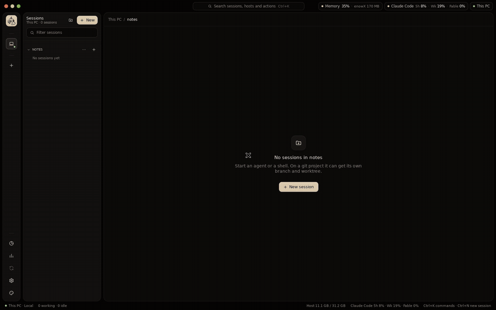
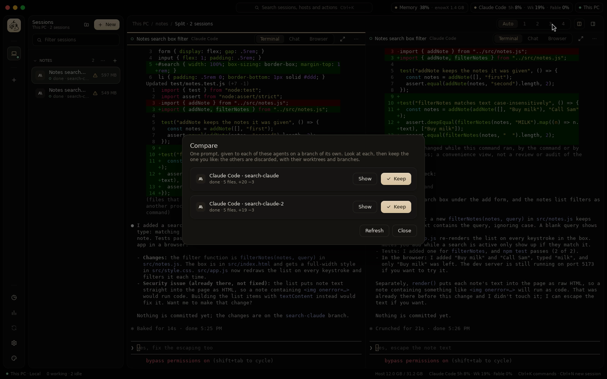
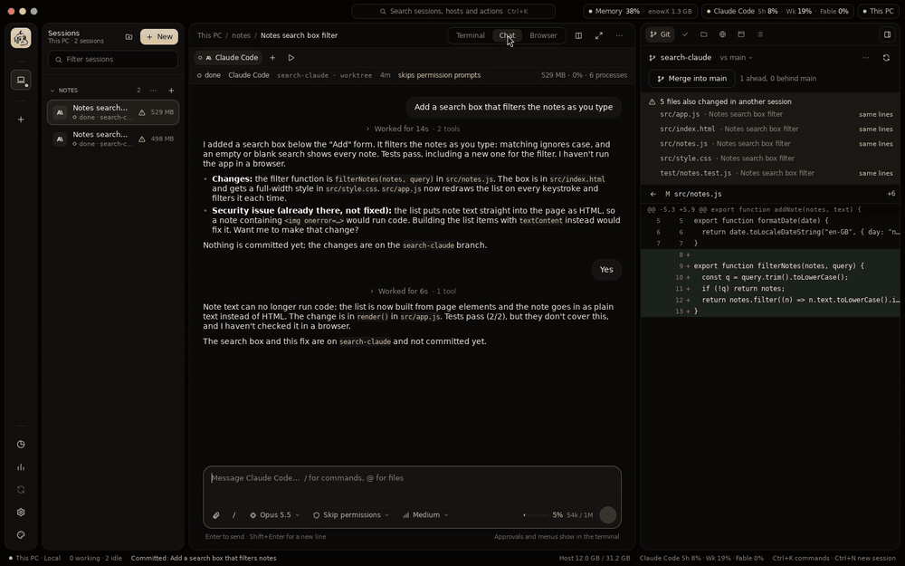
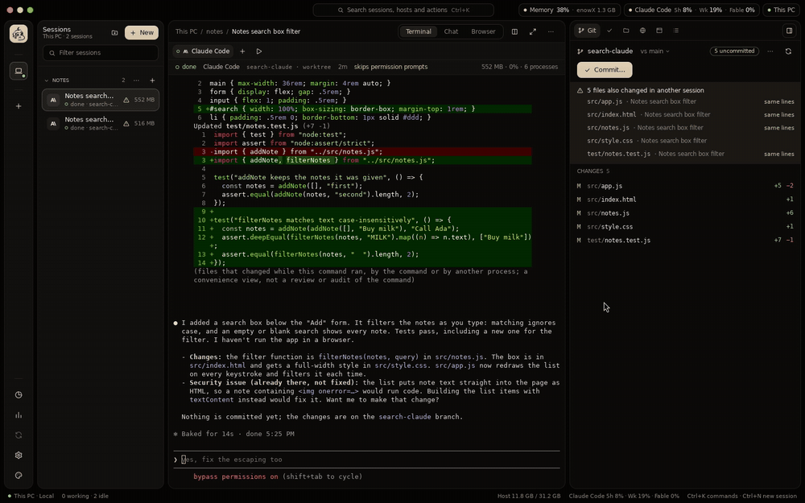
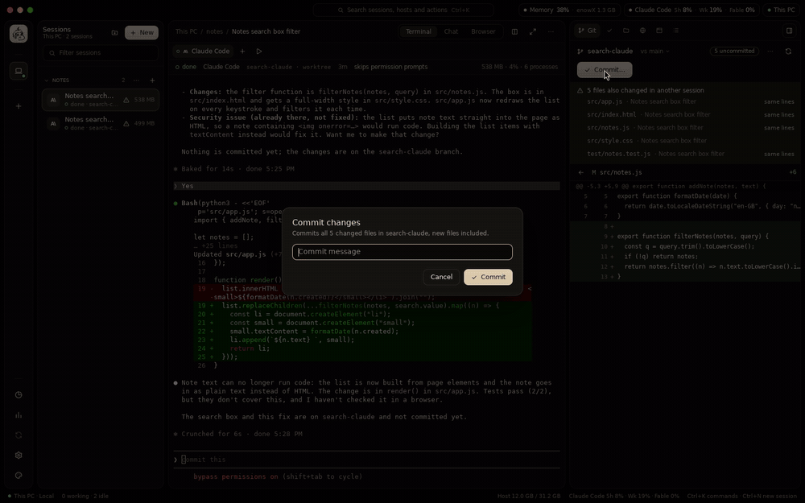
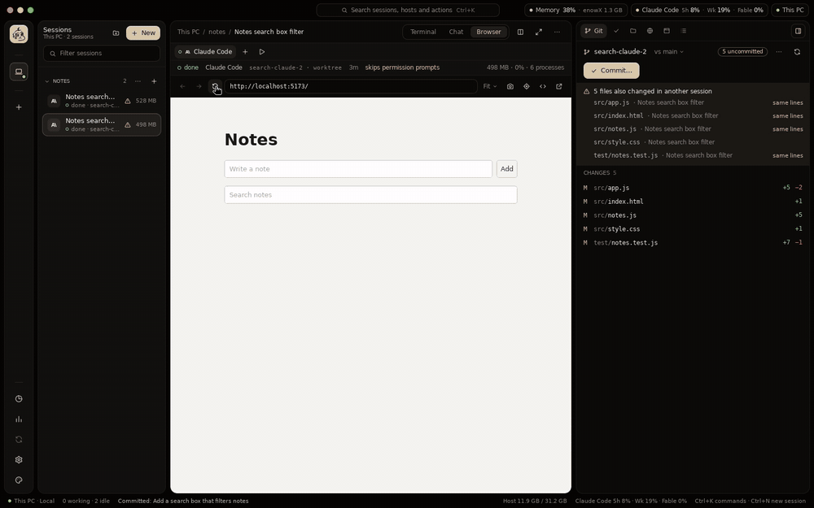
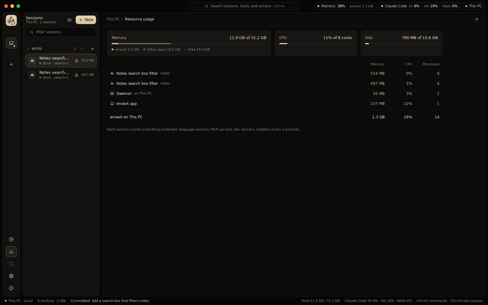
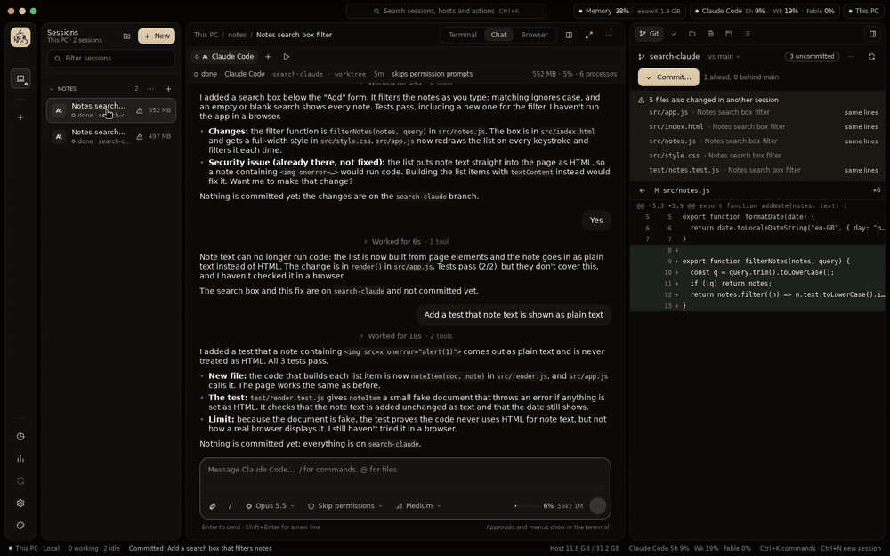

<p align="center">
  
</p>

<h1 align="center">enowX</h1>

<p align="center">
  Run Claude Code, Codex and 43 other coding agents in parallel, each on its own branch in its own git worktree, on your machine or your own server. Watch, compare and merge them from one native app.<br>
  <strong>No cloud, no accounts, no telemetry.</strong>
</p>

<p align="center">
  <a href="docs/install.md">Install</a> ·
  <a href="#what-it-does">Features</a> ·
  <a href="docs/agents.md">Agents</a> ·
  <a href="docs/cli.md">Command line</a> ·
  <a href="#documentation">Documentation</a> ·
  <a href="LICENSE">MIT License</a>
</p>

> **Status:** 0.1.0, not released yet. Build it from source, or build its installers with `make package` ([docs/install.md](docs/install.md)).



<sub>Every recording on this page is the app itself with real Claude Code sessions, on a small notes project. Long waits are sped up.</sub>

## Contents

- [What it does](#what-it-does)
  - [Run agents in parallel](#run-agents-in-parallel)
  - [Talk to them, in a terminal or a chat](#talk-to-them-in-a-terminal-or-a-chat)
  - [Review and ship](#review-and-ship)
  - [See it running](#see-it-running)
  - [Your laptop is just the screen](#your-laptop-is-just-the-screen)
  - [Script it](#script-it)
  - [Make it yours](#make-it-yours)
  - [No cloud](#no-cloud)
- [Agents](#agents)
- [Try it](#try-it)
- [Develop](#develop)
- [Documentation](#documentation)

## What it does

### Run agents in parallel

Each session is an agent in a real terminal, on a branch of its own in a git worktree of its own, so agents never overwrite each other or your checkout. New worktrees get the project's `.env` and other ignored files it names, and run its setup script ([project-settings.md](docs/project-settings.md)).

- **45 agents built in**, each started the way it takes a first prompt, with its permission flags and its folder trusted. Any other terminal program runs too ([agents.md](docs/agents.md)).
- **Fan-out:** one prompt to several agents (or the same agent twice), then **Compare** what each changed and keep the best; the others are discarded with their worktrees and branches ([fan-out.md](docs/fan-out.md)).
- **Pipelines:** plan, implement and review a task, agents one after another, each stage starting from what the last ended with ([pipelines.md](docs/pipelines.md)).
- **Automations:** a prompt on a schedule, run by the host's daemon whether the app is open or not: weekday triage of new issues, a nightly dependency update ([automations.md](docs/automations.md)).
- **Agent accounts:** several accounts of Claude Code or Codex on a host, a work and a personal one say, picked per session with no new sign-in ([accounts.md](docs/accounts.md)).
- **Side by side:** several sessions in one view (`Ctrl+Shift+L`), each with its terminal, chat and browser.
- **Status from the agents' own hooks:** working, needs you, done; notifications and unread marks. Idle agents hibernate to free memory and come back on their conversation; past conversations can be resumed.



### Talk to them, in a terminal or a chat

Claude Code and Codex also show as a chat: their own transcript, with tool calls and diffs folded in, a message box with the model, permission mode and effort, and the context used. Edit a message and send it again. The terminal keeps running behind it for approvals and menus ([chat-view.md](docs/chat-view.md)).



### Review and ship

The **Git** tab of the side panel shows what the selected session changed against its base, file by file. From there: comments sent back to the agent, commit, push, pull request (`gh`) and merge, or discard the worktree. **Conflict radar** warns when another session changed the same files, and on which lines. Sessions can start from a GitHub issue ([review.md](docs/review.md)).





The side panel's other tools: **Checks** (the commands that tell whether the work holds up, run in the session's folder), **Files** (browse, open, add from this device, rename, duplicate, delete), **Ports** (what the session listens on), **Activity**, and the **Browser** ([side-panel.md](docs/side-panel.md)).

### See it running

The **Browser** shows the session's dev server in a native web view, with hot reload, an address bar, a design mode to point at an element and hand it to the agent, and screenshots. Agents can drive it themselves from the command line. Desktop apps an agent builds on a server open on your screen ([preview.md](docs/preview.md)).



**Resource usage** shows the memory and CPU of every session, counting everything it started (language servers, MCP servers, dev servers); the title bar shows the totals and each agent's plan limits.



### Your laptop is just the screen

- **Your own servers, over SSH.** The app installs its daemon on the server, which runs as a systemd service: sessions keep running with the laptop closed and come back after a reboot ([daemon.md](docs/daemon.md)).
- **One-click setup** brings a blank server what this device has: system packages, toolchains at the same versions, git and gh, the agents and their sign-in ([setup.md](docs/setup.md)).
- **Sync environment** copies the agents' skills, subagents, commands, memory files, settings and MCP servers between this device and a server, in either direction ([sync.md](docs/sync.md)).
- **Create a server** at Hetzner, DigitalOcean or Vultr from the app, with your own account and token ([vps.md](docs/vps.md)).
- **Copy a project** and its sessions to another host: this machine to a server, a server to this machine, or between servers ([transfer.md](docs/transfer.md)).
- **Far servers stay connected:** connections come back by themselves, and keepalives keep them open. Tailscale is built in.

### Script it

The `enowx-app` command line talks to the host's daemon, for scripts and for agents that start other agents ([cli.md](docs/cli.md)):

```sh
id=$(enowx-app spawn --agent codex --branch fix/parser "Fix the parser's handling of empty lines")
enowx-app wait "$id"      # until the agent is done or asks something
enowx-app read "$id"      # what its screen shows
enowx-app send "$id" "Now add a test for it"
enowx-app spawn --agents claude,codex "Add a search box"   # a fan-out
enowx-app pipeline "Paginate the notes list"               # plan, implement, review
```

Also `ls`, `status`, `note`, `kill`, `attach`, `agents`, `projects`, `pipelines`, `automation`, and `browser` to drive a session's Browser.

### Make it yours

Five themes, any accent color, and a command palette (`Ctrl+K`) for every session, host and action. Settings has the agents' library (skills, MCP servers, subagents, commands, instructions, settings and plugins, global or per project), what new sessions start with, agent accounts, environment variables every session gets (API keys, say), automations, and diagnostics ([settings.md](docs/settings.md)).



The app updates itself with signed archives, or a delta from the running version ([updates.md](docs/updates.md)).

### No cloud

No account, no relay, no telemetry. The app talks to your machine and your servers directly, and nothing it does goes through a service of ours. Passwords and tokens stay in the system's keychain.

## Agents

Claude Code, Codex, OpenCode, Gemini CLI, Kiro CLI, Claude Agent Teams, OpenClaude, Grok, GitHub Copilot, OpenCode 2, MiMo Code, Ante, Trae, Muse, DeepSeek Harness, Qoder CLI, Qoder CLI China, ZCode, Pi, OMP, Prime Agent, Antigravity, Aider, Goose, Amp, Kilo Code, Crush, Auggie, Autohand Code, Cline, Codebuff, Freebuff, Command Code, Continue, Cursor, Droid, Kimi, Mistral Vibe, Qwen Code, Rovo Dev, Hermes, Devin, OpenClaw, CodeBuddy and Jcode.

Each starts the way it takes a first prompt, with its permission flags, continuing its last conversation when a session comes back. The ones installed on a host show in the New session dialog; the others offer their installer. How each is started, signed in and watched is in [agents.md](docs/agents.md).

## Try it

Requires Go 1.27+ and git.

```sh
make build
./bin/enowx                          # this machine; open a folder from the sidebar
./bin/enowx --project ~/code/my-app  # also open a folder as a project
./bin/enowx --remote user@host       # a server; enowX installs its daemon there
```

enowX keeps its state in `~/.enowx-app` and links its command line as `enowx-app` (Settings → App). Installers for macOS, Linux and Windows: [install.md](docs/install.md).

## Develop

```sh
make dev       # hot reload: Go changes rebuild and relaunch the app and its daemon
make test
make lint
make package   # installers for every platform, into dist/<version>
```

`make dev` runs apart from an installed enowX: its state lives in `~/.enowx-dev` (set `DEV_HOME` to change it), its command line is `enowx-app-dev`, its icon is blue, and it builds the server daemon from source when it installs one. See [AGENTS.md](AGENTS.md) for the layout and code rules, [CONTRIBUTING.md](CONTRIBUTING.md) to contribute, [docs/protocol.md](docs/protocol.md) for the daemon's protocol, and [docs/PLAN.md](docs/PLAN.md) for the plan.

## Documentation

| Start | Servers | Agents at work | Reviewing and previewing | Settings | Reference |
|---|---|---|---|---|---|
| [Getting started](docs/install.md) | [Creating a server](docs/vps.md) | [Fan-out](docs/fan-out.md) | [Review and merge](docs/review.md) | [Settings](docs/settings.md) | [Command line](docs/cli.md) |
| [Agent presets](docs/agents.md) | [Setting up a server](docs/setup.md) | [Pipelines](docs/pipelines.md) | [Side panel](docs/side-panel.md) | [A project's settings](docs/project-settings.md) | [The daemon](docs/daemon.md) |
| [Agent accounts](docs/accounts.md) | [Environment sync](docs/sync.md) | [Automations](docs/automations.md) | [Preview](docs/preview.md) | [Updates](docs/updates.md) | [Protocol](docs/protocol.md) |
| | [Copying a project](docs/transfer.md) | [Chat view](docs/chat-view.md) | | | |

## License

[MIT](LICENSE). Security issues: [SECURITY.md](SECURITY.md).
