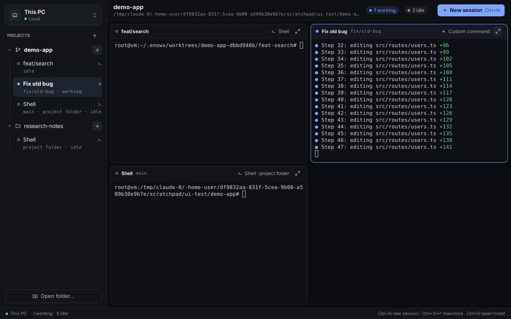

# enowX

A lightweight orchestrator for coding agents. Run Claude Code, Codex and 43 other agents in parallel, each on its own branch in its own git worktree, on your machine or on your own server, and watch, compare and merge them from one native app. No cloud, no accounts, no telemetry.

> **Status:** 0.1.0, not released yet. Build it from source, or its installers with `make package` ([docs/install.md](docs/install.md)).



## What it does

**Run agents in parallel**
- A session per agent, on its own branch in its own worktree, with the project's `.env` and setup carried over ([project-settings.md](docs/project-settings.md)).
- 45 agents built in, each started the way it takes a first prompt, with its permission flags and its folder trusted; any other terminal program runs too ([agents.md](docs/agents.md)).
- **Fan-out:** one prompt to several agents, then compare what each changed and keep the best ([fan-out.md](docs/fan-out.md)).
- **Pipelines:** plan, implement and review a task, agents one after another ([pipelines.md](docs/pipelines.md)).
- **Automations:** a prompt on a schedule, such as weekday triage or nightly dependency updates ([automations.md](docs/automations.md)).
- **Agent accounts:** several accounts of Claude Code or Codex, picked per session ([accounts.md](docs/accounts.md)).
- Idle agents hibernate to free memory and come back on their conversation; past conversations can be resumed.

**See what they do**
- Real terminals, and Claude Code and Codex also as a chat, with tool calls and diffs; edit a message and send it again ([chat-view.md](docs/chat-view.md)).
- Status from the agents' own hooks (working, needs you, done), notifications and unread marks.
- The side panel: changes, files (add from this device, rename, duplicate, delete, properties), checks, ports, activity, and a browser for dev servers with hot reload and design mode ([side-panel.md](docs/side-panel.md), [preview.md](docs/preview.md)).
- Memory and CPU of every session, in the title bar and on Resource usage.

**Review and ship**
- Each session's diff against its base, comments sent back to the agent, commit, push, pull request and merge; sessions from GitHub issues ([review.md](docs/review.md)).

**Your laptop is just the screen**
- The same workspace on your own server over SSH: the app installs its daemon, which runs as a systemd service, so sessions keep running with the laptop closed and come back after a reboot ([daemon.md](docs/daemon.md)).
- One-click setup brings a blank server your toolchains, git, gh, agents, skills and MCP servers; Sync keeps them in step ([setup.md](docs/setup.md), [sync.md](docs/sync.md)).
- Create servers at Hetzner, DigitalOcean or Vultr from the app ([vps.md](docs/vps.md)); move a project and its sessions between hosts ([transfer.md](docs/transfer.md)).
- Far servers stay connected: connections come back by themselves, keepalives keep them open. Tailscale is built in.
- Desktop apps an agent builds on a server open on your screen.

**Script it**
- The `enowx-app` command line: `spawn` (one agent or a fan-out), `wait`, `read`, `send`, `browser`, `pipeline`, `automation`…, for scripts and for agents starting other agents ([cli.md](docs/cli.md)).

**No cloud**
- No account, no relay, no telemetry. The app talks to your machine and your servers directly; passwords and tokens stay in the system's keychain.

## Try it

Requires Go 1.27+ and git.

```sh
make build
./bin/enowx                          # this machine; open a folder from the sidebar
./bin/enowx --project ~/code/my-app  # also open a folder as a project
./bin/enowx --remote user@host       # a server; enowX installs its daemon there
```

enowX keeps its state in `~/.enowx-app` and links its command line as `enowx-app` (Settings → App).

## Develop

```sh
make dev       # hot reload: Go changes rebuild and relaunch the app and its daemon
make test
make lint
make package   # installers for every platform, into dist/<version>
```

`make dev` runs apart from an installed enowX: its state lives in `~/.enowx-dev` (set `DEV_HOME` to change it), its command line is `enowx-app-dev`, its icon is blue, and it builds the server daemon from source when it installs one. See [AGENTS.md](AGENTS.md) for the layout and code rules, [docs/protocol.md](docs/protocol.md) for the daemon's protocol, and [docs/PLAN.md](docs/PLAN.md) for the plan.

## License

[MIT](LICENSE)
