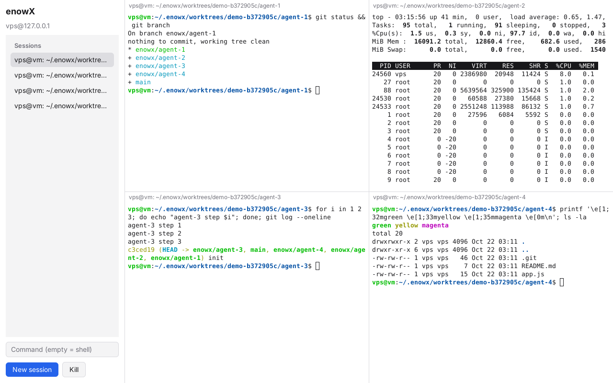

# Phase 0 spike: results

Goal (from [PLAN.md](../PLAN.md#phase-0-spike-12-weeks)): prove the stack, a daemon that owns terminal sessions and a native MyGo app that views them, locally and over SSH.

*The app connected over SSH to a separate user's daemon ("the VPS"), with four sessions each in its own worktree on branch `enowx/agent-N`. `top` keeps running in one pane.*

## What was built

| Piece | Where | What it does |
|---|---|---|
| Wire protocol | `proto/` | Length-prefixed frames with channels. JSON control (hello, request/response, events), raw binary terminal frames, in-band resize notices |
| Sessions | `core/session` | Each session runs a program in a PTY and emulates its screen in a headless MyGo terminal (libghostty-vt) |
| Worktrees | `core/worktree` | Idempotent `git worktree add` on `enowx/<name>` branches under `~/.enowx/worktrees` |
| Daemon | `daemon/`, `cmd/enowxd` | Unix socket server; one `Mirror` per attached client sends only what changed; `bridge` pipes stdin/stdout to the socket |
| Client | `client/` | RPC + streams; a stream is the `Conn` of a client-side terminal with `ResizeByConn` |
| Transport | `transport/` | Local socket (auto-starts the daemon detached), SSH (agent/default keys, known_hosts checked) |
| App | `cmd/enowx`, `ui/` | Sidebar of sessions + grid of terminals; `--remote`, `--repo/--agent/--count` |

## Results

Measured on Linux (x86-64), app under Xvfb with CPU rendering, "VPS" = a second Unix user reached through OpenSSH on localhost. Latency is from writing a keystroke to its echo arriving in a frame on the client.

| Criterion | Result | Status |
|---|---|---|
| Typing latency, local socket | p50 2.9 ms, p90 4.0 ms, max 6.2 ms | ✅ |
| Typing latency, over SSH | p50 3.1 ms, p90 4.3 ms, max 6.9 ms (+ network RTT on a real VPS) | ✅ |
| Sessions survive app close / reconnect | Screen and scrollback restored cell for cell; programs (`top`) kept running | ✅ |
| Relaunch with same `--repo` reuses worktrees and sessions | No duplicates | ✅ |
| 4 terminals over SSH, 8 terminals locally | Works, including TUIs and 24-bit/ANSI color; local mode auto-starts `enowx daemon` | ✅ |
| Daemon resources (4 attached streams, `top` running) | ~4.6% CPU, ~20 MB RSS | ✅ |
| App resources (CPU rendering) | ~112 MB RSS with 4 terminals, ~101 MB with 8; local daemon ~25 MB | ✅ |
| Binary sizes | app 19 MB, daemon 13.5 MB (+ libghostty-vt ~3 MB) | ✅ |
| Cross-compilation | darwin/amd64, darwin/arm64, windows/amd64, windows/arm64, linux/arm64 all build without cgo | ✅ |
| Runs on macOS and Windows | **Not verified yet** (built only) | ⏳ |
| `claude` in each worktree | Not run in the spike environment; any CLI works through `--agent` | ⏳ |

## Findings

1. **MyGo's terminal plugin fits the architecture exactly.** `Mirror` on the daemon + `Conn`/`ResizeByConn` on the client give correct reattach without replaying raw output, which would garble agent TUIs that redraw with relative cursor moves.
2. **Frame polling must be adaptive.** A fixed 8 ms poll per stream cost ~13% CPU with 4 streams. Polling every 2 ms for 30 ms after input, 8 ms while the screen changes and 50 ms when idle cut that to ~4.6% *and* lowered typing latency from ~8 ms to ~3 ms. A push notification for "output arrived" in the terminal plugin would remove polling entirely; worth proposing upstream.
3. **Event ordering matters.** A killed session's exit callback raced the removal event and revived it in the UI. Fixed by never announcing sessions that are no longer registered, plus a client-side tombstone.
4. **Don't size sessions before a client does.** Starting a shell at 80x24 and resizing it right away left a stale prompt line. Sessions created without a size now start at the first client's size.
5. **SSH via `enowxd bridge`** (stdin/stdout ⇄ socket) works with stock OpenSSH and needs no port forwarding or `AllowStreamLocalForwarding`.

## Open items before Phase 1

- [ ] Run the app on macOS and Windows (GPU rendering, ConPTY, Unix sockets on Windows).
- [ ] Run real agents (Claude Code, Codex) in the grid and check their TUIs end to end.
- [ ] Measure over a real VPS (RTT 30–150 ms) and with 8+ terminals.
- [ ] Forward the window theme to the daemon (`UseTheme`) so programs asking for colors get the right answer.
- [ ] Decide whether the daemon should keep `libghostty-vt` next to its binary on servers (today it downloads into the user cache on first run).
